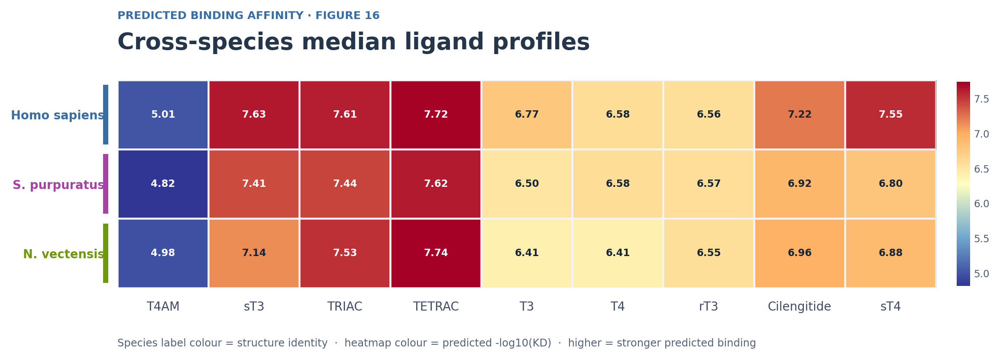
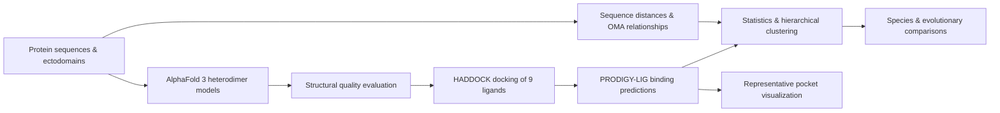
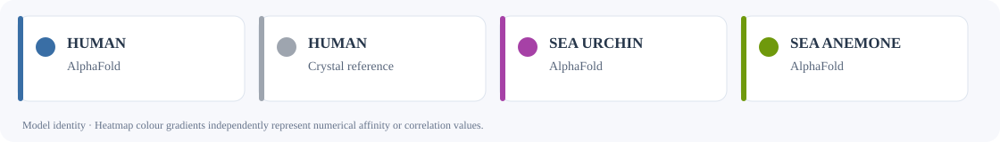

# Comparative Structural Analysis of RGD-Binding Integrins and Their Ability to Bind Thyroid Hormones

**MSc Bioinformatics thesis · University of Guelph · 2026**  
**Dilma Karunathilake · Heyland Lab**

### [Explore the interactive results atlas ↗](https://dkarunat123.github.io/MSc.-Structural-Analysis-of-RGD-Binding-Integrins-and-Their-Ability-to-Bind-Thyroid-Hormones/)

Explore the **48 modelled integrin heterodimers**, **9 ligands**, and **432 computational binding-affinity predictions** across three metazoan species. Switch species, inspect affinity and correlation values, and export figures or data in the full interactive atlas.

**Browse the results:** [Figure 14 · Receptor affinities](https://dkarunat123.github.io/MSc.-Structural-Analysis-of-RGD-Binding-Integrins-and-Their-Ability-to-Bind-Thyroid-Hormones/) · [Figure 15 · Ligand correlations](https://dkarunat123.github.io/MSc.-Structural-Analysis-of-RGD-Binding-Integrins-and-Their-Ability-to-Bind-Thyroid-Hormones/) · [Figure 16 · Cross-species profiles](https://dkarunat123.github.io/MSc.-Structural-Analysis-of-RGD-Binding-Integrins-and-Their-Ability-to-Bind-Thyroid-Hormones/)

*The interactive controls run in the GitHub Pages website, not directly inside this README. If the atlas link is not live yet, go to your repository's **Settings → Pages → Deploy from a branch → `main` → `/docs` → Save**.*

### A look at the results



*Figure 16 — median predicted −log₁₀(KD) by species and ligand. Higher scores indicate stronger **predicted** binding. The static preview is an illustration; inspect the values interactively in the atlas.*

[**Download receptor-level scores (CSV)**](docs/data/receptor_affinities.csv) · [Data validation and provenance](docs/data/validation_report.json) · [Installation and reproduction guide](INSTALLATION.md)

---

## Research question

Integrin **αVβ3** is an experimentally characterized cell-surface thyroid hormone receptor. Does structural compatibility with thyroid hormones extend to other RGD-binding integrins, including integrins from deeply diverged metazoan lineages?

This study combined **AlphaFold 3**, **HADDOCK 2.4**, **PRODIGY-LIG 1.1.4**, sequence and OMA orthology analyses, and statistical comparisons of predicted ligand-affinity patterns. The work investigated **8 human RGD-binding heterodimers**, **24 modeled sea urchin candidates**, and **16 modeled sea anemone candidates**. Non-human pairings are computational hypotheses, not experimentally established receptor pairings.

| Study species | Integrin models | Modelled ligand combinations |
|---|---:|---:|
| *Homo sapiens* | 8 | 72 |
| *Strongylocentrotus purpuratus* | 24 | 216 |
| *Nematostella vectensis* | 16 | 144 |
| **Total** | **48** | **432** |

The nine ligands were **Cilengitide** (RGD-mimetic reference), **T3**, **T4**, **rT3**, **sT3**, **sT4**, **TRIAC**, **TETRAC**, and **T4AM**.

## Key results

- **Candidate thyroid hormone interactions beyond αVβ3.** All eight human RGD-binding integrin models showed structurally plausible predicted interactions. Human **αVβ8** had especially favorable model-based affinity estimates, but their magnitude was sensitive to the chosen receptor structure.
- **Recurring ligand preferences.** **TRIAC and TETRAC** were among the strongest median predicted ligands across all three species; **T4AM** consistently showed the weakest median predicted affinity.
- **Cross-species similarity.** Spearman correlations between species-level nine-ligand median profiles were **ρ = 0.917** (human/sea urchin), **0.900** (human/sea anemone), and **0.983** (sea urchin/sea anemone).
- **Structural context.** Representative thyroid hormone docking poses occupied the MIDAS-associated region, although ligand orientation, nearby ions, and residue contacts varied among models.

> **Scope:** Binding affinities and docking poses are computational predictions, *not* experimentally measured KD values or evidence of physiological binding or signaling. Similar rankings can partly reflect common chemical properties and a shared modeling/scoring pipeline. See thesis Discussion §§4.1–4.3.

## Explore the interactive figures

| Visualization | What it answers | Data source | Clustering |
|---|---|---|---|
| **Figure 14** · Receptor × ligand heatmaps | Which modeled heterodimers have relatively high predicted affinities for each ligand? | [432 receptor–ligand scores](docs/data/receptor_affinities.csv) | Euclidean distance, complete linkage; independent species-specific color scales by default |
| **Figure 15** · Ligand Spearman heatmaps | Do pairs of ligands rank integrin receptor models similarly within a species? | [H. sapiens](docs/data/figure15_H_sapiens_rho.csv) · [S. purpuratus](docs/data/figure15_S_purpuratus_rho.csv) · [N. vectensis](docs/data/figure15_N_vectensis_rho.csv) | Distance = 1 − ρ; complete linkage; shared scale from −1 to +1 |
| **Figure 16** · Species-level medians | Do the overall median ligand preferences differ across species? | [27 median scores](docs/data/species_medians.csv) · [3 cross-species ρ values](docs/data/species_rank_correlations.csv) | Euclidean distance, complete linkage; unstandardized medians |

Species-specific headings, heatmap row labels, selection accents and exported SVGs follow the original thesis model colours against a light, pastel background, with a separate identity legend so the underlying numerical scales are never confused with model identity. The atlas supports **selecting species, changing display order, searching ligands, inspecting cell values, toggling a shared Figure 14 color scale, exporting the visible CSV, and downloading SVG figures**. Its dashboard data are bundled so the HTML can also be opened locally.

**Faithfulness to the original figures:** The displayed numerical values are cross-checked against the source spreadsheets and correlations. Interactive clustering follows the thesis' stated distance/linkage methods but was independently recalculated from the numerical tables. A dendrogram's left/right leaf orientation may differ from the original R output. **Figure 14 AU bootstrap support labels are intentionally omitted** until the original `pvclust` `.rds` objects and associated edge/cluster tables are available. No AU support values are invented.

## Computational workflow



### Reproduce the main statistical figures

In the repository root, prepare the following inputs in `Data/`:

- `All_Species_BindingScores.xlsx`
- `BindingScores_StatisticalAnalysis.xlsx`
- `OMA_Subunit_Relationships.xlsx` (already present in the repository screenshots; it is *not* included in the upgrade ZIP)

Then execute the numbered R scripts from the **repository root**, so their relative `Data/` and `Results/` paths resolve correctly:

```bash
Rscript Scripts/R_Scripts/02_Prepare_Integrin_BindingData.R
Rscript Scripts/R_Scripts/04_LigandCluster_BootstrapAnalysis.R
Rscript Scripts/R_Scripts/05_Species_BindingAffinity_Analysis.R
Rscript Scripts/R_Scripts/06_CrossSpecies_LigandProfile_Comparison.R
```

**Warning:** Script 04 performs **1,000,000 bootstrap replicates at each of ten resampling scales per species**. It saves `.rds` files for reuse when the source fingerprints and settings match. Do not rerun unnecessarily. Script 05 requires the Script 04 outputs; Script 06 requires the Script 05 descriptive statistics. Other analyses depend on Scripts 01, 03 and 07, plus preparation scripts and external services documented in the thesis. Full computational reruns also require the original AlphaFold, docking and structural inputs.

See [the detailed dashboard and regeneration notes](docs/README.md) for what is included, which checks were performed, and which original outputs are still needed to reproduce AU annotations exactly.

## Repository organization

The existing project uses `Data/`, `Docking/`, `Figures/` and `Scripts/`. The upgrade adds a `docs/` interactive explorer, selected statistical input/output files, `CITATION.cff`, and an [audit of remaining reproducibility tasks](REPOSITORY_AUDIT.md).

| Path | Content |
|---|---|
| [`Data/`](Data/) | Sequence workbooks, receptor metadata, raw KD data and precomputed affinity-score workbook |
| [`Docking/`](Docking/) | Prepared HADDOCK inputs, selected complexes, and reported docking outputs |
| [`Figures/`](Figures/) | Original PyMOL session files and figure resources |
| [`Scripts/R_Scripts/`](Scripts/R_Scripts/) | R scripts for data preparation, bootstrap analysis, statistical figures and cross-species comparison |
| [`docs/`](docs/) | Interactive atlas, figure preview, downloadable numerical tables and validation report |
| [`Results/`](Results/) | Generated R analysis outputs; included correlation table can be kept in Script 05's result folder |

The complete thesis also refers to `Structures/` and `Supplementary/`; please verify their presence in the current `main` branch and link them here when their contents are finalized. For a file-by-file audit, see [REPOSITORY_AUDIT.md](REPOSITORY_AUDIT.md).

## Scientific interpretation

- **Raw KD** values in the supplied workbook are predicted dissociation constants in M. The analysis workbook stores **−log₁₀(KD)**; it should **not** be transformed a second time.
- For Figure 16, medians are calculated in **−log₁₀(KD) space**. For comparisons requiring the median *raw* KD (notably Figure 18), take the median of raw KD directly; for an even number of receptors it need not equal `10^(-median(-log10(KD)))`.
- The 24 sea urchin and 16 sea anemone pairings are **computationally modeled candidates**, not validated physiological receptor pairings or biological replicates.
- The AlphaFold modelling protocol supplied eight Mn²⁺ ions; their presence in models does not independently establish conserved ion occupancy. Some predicted metal–ligand distances were shorter than typical physical coordination distances, so interpreted poses are **metal-proximal predictions**, not confirmed coordination geometries.

## Thesis structure colour key



The **original, saturated organism colours** are used for model identity in the interactive atlas. The surrounding site uses a pale blue/lavender background with white panels. Heatmap fills preserve independent *quantitative* affinity and correlation colour scales, rather than using species colours to encode numeric values. The Figure 14–16 plots are based on AlphaFold models; grey crystal-structure references are reserved for structural comparisons.

## Citation and reuse

**Thesis:** Karunathilake, D. (2026). *Comparative Structural Analysis of RGD-Binding Integrins & Their Ability to Bind Thyroid Hormones*. MSc thesis, University of Guelph. Advisors: Andreas Heyland and Matthew Kimber.

A repository [citation file](CITATION.cff) is included. Please also acknowledge original sequence/structure databases, modelling services and software. **A repository-wide license is not supplied automatically**: assess redistribution rights for third-party structures, ligand files, figures, models and the author's original code/data before choosing a license.
