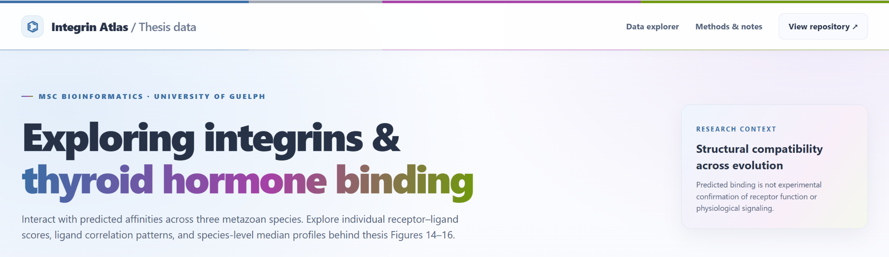

# Comparative Structural Analysis of RGD-Binding Integrins and Their Ability to Bind Thyroid Hormones

**MSc Bioinformatics thesis · University of Guelph · 2026**  
Dilma Karunathilake · Heyland Lab

## Abstract

Integrin αVβ3 mediates non-genomic thyroid hormone signaling, but whether this capacity extends to other integrins or predates vertebrates remains unclear. This study investigated predicted thyroid hormone binding in eight human RGD-binding integrins and 40 candidate heterodimers from the sea urchin *Strongylocentrotus purpuratus* and sea anemone *Nematostella vectensis*. Integrin ectodomains were modeled using AlphaFold 3, docked with thyroid hormone derivatives using HADDOCK, and evaluated using PRODIGY-LIG alongside sequence and orthology analyses. All eight human receptors and multiple non-human models exhibited structurally plausible interactions, with human αVβ8 showing particularly favorable predicted affinities. Across species, ligand-affinity rankings were strongly correlated (Spearman ρ = 0.900–0.983), with TRIAC and TETRAC generally favored and T4AM consistently weakest. Conserved binding-pocket architecture and similar affinities among β1-related integrins suggest an evolutionarily ancient structural compatibility with thyroid hormones. These computational findings identify candidate receptors but do not establish physiological binding or signaling.

## Repository contents

**48 integrin models · 9 ligands · 432 computational binding-affinity predictions · 3 species**

- **Interactive atlas:** [Open the website](https://dkarunat123.github.io/MSc.-Structural-Analysis-of-RGD-Binding-Integrins-and-Their-Ability-to-Bind-Thyroid-Hormones/) for interactive versions of thesis Figures 14–16.
- **`Data/` and `Results/`:** analysis inputs and derived outputs.
- **`Scripts/`:** R and Python scripts used for data processing, statistics, clustering, and figure generation.
- **`Docking/` and `Figures/`:** structural models, docking files, and figure-related materials.
- **`docs/`:** source files for the GitHub Pages atlas.

## Citation

Karunathilake, D. (2026). *Comparative Structural Analysis of RGD-Binding Integrins and Their Ability to Bind Thyroid Hormones*. MSc thesis, University of Guelph. Advisors: Andreas Heyland and Matthew Kimber.
