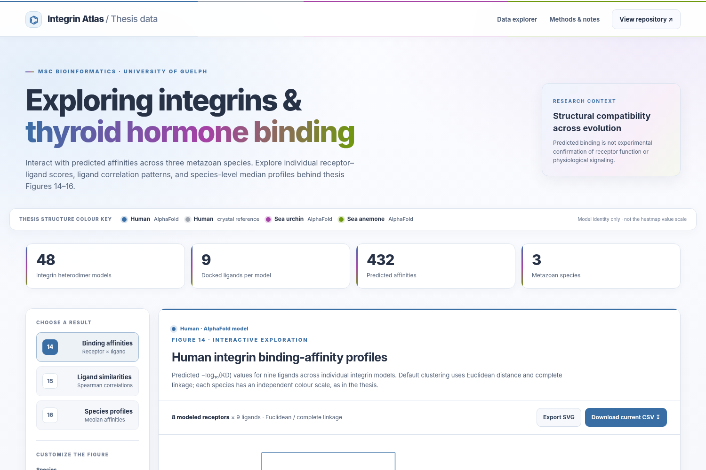

# Comparative Structural Analysis of RGD-Binding Integrins and Their Ability to Bind Thyroid Hormones

**MSc Bioinformatics thesis · University of Guelph · 2026**  
Dilma Karunathilake · Heyland Lab

### [Explore the interactive thesis results atlas ↗](https://dkarunat123.github.io/MSc.-Structural-Analysis-of-RGD-Binding-Integrins-and-Their-Ability-to-Bind-Thyroid-Hormones/)

*Click the preview to explore Figures 14–16: receptor–ligand affinity heatmaps with original AU bootstrap support, ligand correlations, and cross-species median profiles.*

## Abstract

Integrin αVβ3 mediates non-genomic thyroid hormone signaling, but whether this capacity extends to other integrins or predates vertebrates remains unclear. This study investigated predicted thyroid hormone binding in eight human RGD-binding integrins and 40 candidate heterodimers from the sea urchin Strongylocentrotus purpuratus and sea anemone Nematostella vectensis. Integrin ectodomains were modeled using AlphaFold 3, docked with thyroid hormone derivatives using HADDOCK, and evaluated using PRODIGY-LIG alongside sequence and orthology analyses. All eight human receptors and multiple non-human models exhibited structurally plausible interactions, with human αVβ8 showing particularly favorable predicted affinities. Across species, ligand-affinity rankings were strongly correlated (Spearman ρ = 0.900-0.983), with TRIAC and TETRAC generally favored and T4AM consistently weakest. Conserved binding-pocket architecture and similar affinities among β1-related integrins suggest an evolutionarily ancient structural compatibility with thyroid hormones. These computational findings identify candidate receptors but do not establish physiological binding or signaling.

## Explore the research

**48 integrin models · 9 ligands · 432 computational binding-affinity predictions · 3 species**

| Resource | What's inside |
|---|---|
| **[Interactive results atlas](https://dkarunat123.github.io/MSc.-Structural-Analysis-of-RGD-Binding-Integrins-and-Their-Ability-to-Bind-Thyroid-Hormones/)** | Figures 14–16 with interactive values, AU bootstrap annotations, and CSV/SVG exports |
| [`Data/`](Data/) · [`Results/`](Results/) | Analysis inputs and derived results |
| [`Scripts/`](Scripts/) | Python and R analysis scripts |
| [`Docking/`](Docking/) · [`Figures/`](Figures/) | Docking files and visualizations |
| [`INSTALLATION.md`](INSTALLATION.md) · [`docs/README.md`](docs/README.md) | Reproducibility and dashboard documentation |

**Download data:** [Receptor-level affinity predictions (CSV)](docs/data/receptor_affinities.csv) · [Figure 14 AU/BP cluster support (CSV)](docs/data/figure14_bootstrap_support.csv)

## Citation

Karunathilake, D. (2026). *Comparative Structural Analysis of RGD-Binding Integrins & Their Ability to Bind Thyroid Hormones*. MSc thesis, University of Guelph. Advisors: Andreas Heyland and Matthew Kimber. See [`CITATION.cff`](CITATION.cff) for repository citation metadata.
